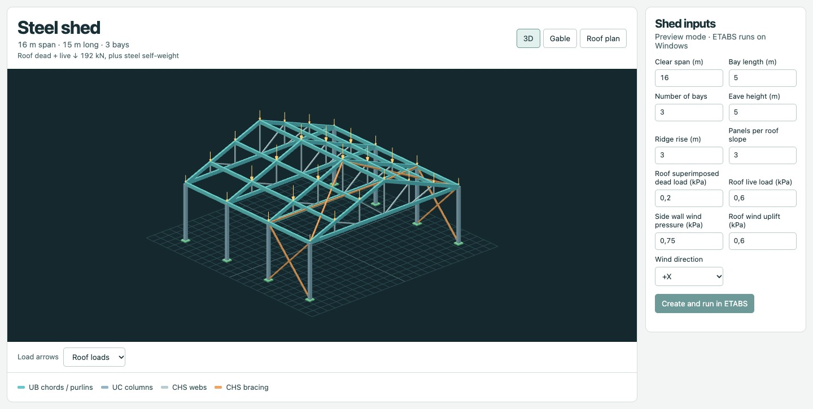
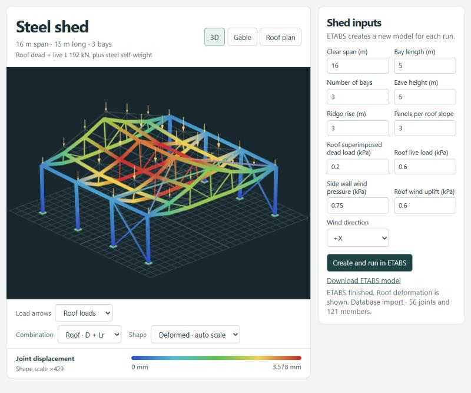

# ETABS steel shed demo

Configure a gable-roof steel shed, preview roof and wind loads in 3D, and run a linear analysis in ETABS.





## Windows setup

Install Python 3.12 and ETABS with an active license. In PowerShell, run these commands from the repository folder.

```powershell
py -3.12 -m venv .venv
.\.venv\Scripts\python.exe -m pip install -r requirements.txt
.\.venv\Scripts\python.exe server.py
```

Open [http://127.0.0.1:8011](http://127.0.0.1:8011). Edit the inputs and select **Create and run in ETABS**. The app opens a new model and imports the geometry through ETABS editable database tables. Select **Download ETABS model** to get the `.edb`.

The deformation view starts with **Roof · D + Lr**. Select **Wind · D + W** to change the combination. Blue shows low joint displacement and red shows the maximum, in millimetres. Select **1×** for true scale.
